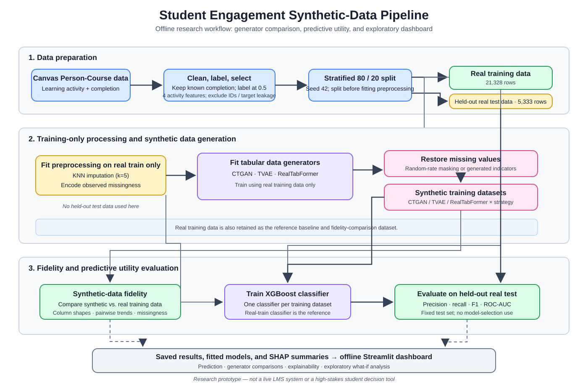
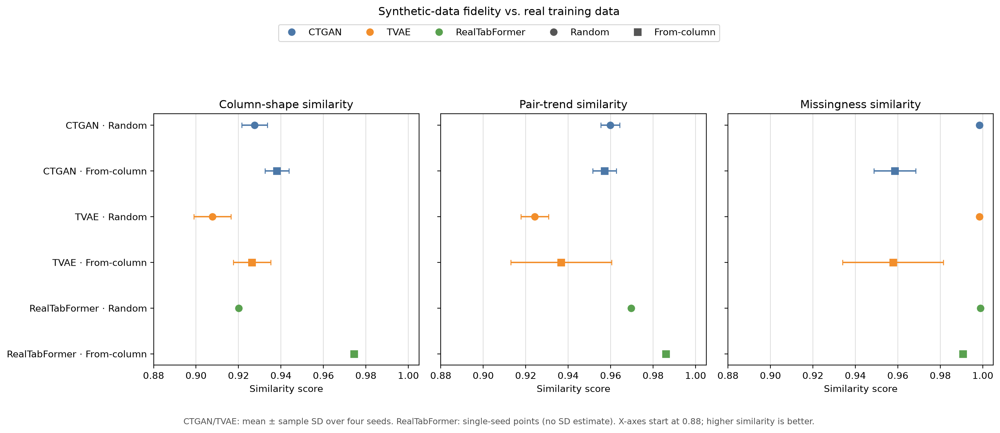
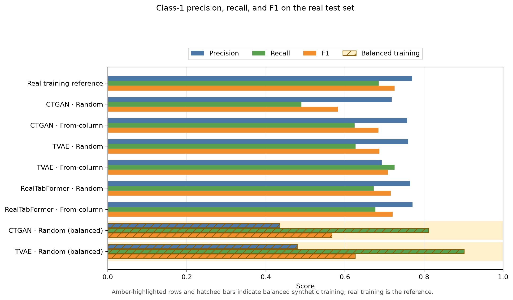

# Reproducing a Synthetic-Data Digital Twin for Student Engagement Prediction

**Research-oriented master’s capstone report**

**Date:** 8 November 2026

## Abstract

This project independently implements and extends the missingness-aware synthetic-data
framework of Kumi et al. (2025) for predicting student engagement from learning
management system activity. The Canvas Network Person-Course dataset was filtered to
26,661 records with known completion labels and divided, before fitting preprocessing,
into stratified training and held-out test sets (21,328 and 5,333 records; seed 42).
CTGAN, TVAE, and RealTabFormer were used to generate synthetic records with
proportion-based or missingness-indicator-based restoration. Synthetic data were
compared with real training data for statistical fidelity, then used alone to train
XGBoost classifiers evaluated on the untouched real test set. CTGAN/TVAE fidelity
averaged 0.9160–0.9476 across four seeds; the single-seed RealTabFormer
from-column run scored 0.9802. The best unbalanced synthetic-trained high-engagement
F1 was 0.7198 (RealTabFormer from-column); balancing raised recall but reduced
precision. The paper’s abstract reports F1 above 0.80 but does not specify averaging,
so that value is not directly comparable: our balanced models exceeded 0.80 weighted
F1, while their high-engagement F1 was 0.5668–0.6256. Results are limited by single-
seed utility estimates for several comparisons and do not establish privacy, fairness,
or causal effects.

## 1. Introduction

Learning-management systems record student interactions, but activity fields may be
missing for many students. Missingness can reflect actual engagement choices as well
as data-collection gaps. Discarding incomplete records or imputing without representing
the missingness process may remove useful information. The published framework by
Kumi et al. (2025) uses synthetic student data and reversible transformations to
preserve missingness while evaluating engagement prediction.

This capstone asks whether the framework’s main claims are reproduced under an
independent implementation and whether alternative missingness and class-balancing
choices change predictive performance. It addresses three research questions:

- **RQ1:** Do the paper’s fidelity and utility claims hold when its pipeline is
  reimplemented independently?
- **RQ2:** Does modelling missingness indicators (`from_column`) improve downstream
  prediction over proportion-based random masking?
- **RQ3:** Does class balancing improve minority-class detection, or mainly shift the
  precision/recall trade-off?

This report contributes (i) a reproducible pipeline comparing three tabular
generators and two missingness-restoration strategies, (ii) separate fidelity and
downstream utility evaluations with class-wise metrics, and (iii) a SHAP-enabled
interactive research dashboard. The report first summarizes the reference paper,
then describes data and methods, reports findings, and discusses limitations and
implications.

## 2. Background

Kumi et al. propose a synthetic “digital twin” of LMS learning activity that retains
observed missingness, using CTGAN, TVAE, and RealTabFormer with reversible data
transformations. Their abstract states that CTGAN and TVAE generated balanced
synthetic data that captured meaningful real-data patterns and that XGBoost trained
on a balanced synthetic replica achieved an F1-score above 80% on real data with
complete and incomplete entries. The abstract does not identify the F1 averaging
method or provide a directly comparable table of per-class values. Accordingly,
the reported score is treated here as a **reference, not a target**; the full paper
should be consulted for details beyond its abstract.

## 3. Methodology

### 3.1 Data and leakage control

The source is the de-identified Canvas Network Person-Course dataset for January
2014–September 2015. Records without `completed_%` were excluded. The binary target
is 1 when `completed_%` is at least 0.5 and 0 otherwise; the completion field and
identifiers were excluded from model features. The four predictors are `nevents`,
`ndays_act`, `ncontent`, and `nforum_posts`.

The target-bearing data were split once using stratified 80/20 sampling with seed 42.
The KNN imputer (k=5) and missingness rates were fitted/derived from real training
data only. Generator fitting and synthetic-data training used training data only.
Fidelity was measured against real training data; utility was evaluated on the
fixed real test set with original missing values. **The test set was not used for
preprocessing fits, generator training, hyperparameter selection, or model selection.**
It was used only for final utility evaluation and post-fit SHAP interpretation.

### 3.2 Missingness strategies and generators

KNN imputation with k=5 produces complete generator inputs; the fitted imputer uses
training features only. Missingness is then restored by one of two approaches:

1. **Random / proportion-based:** independently mask each generated feature using
   that feature’s missing rate in the real training set and a fixed seed.
2. **From-column / indicator-based:** include binary missingness indicators for
   features that had missing values in the training data, generate them jointly with
   the activity features, and restore missing values where a generated indicator is 1.

CTGAN and TVAE fidelity were assessed over seeds 42, 123, 2026, and 3407. The
classification comparison uses the saved seed-42 synthetic datasets and XGBoost
configuration. Full-size RealTabFormer runs generated 21,328 records per strategy,
with seed 42 and up to 6,600 training steps; its classification/fidelity values are
single-seed estimates. A completed random-strategy checkpoint was recovered to save
the generator and generation report, without retraining.

### 3.3 Evaluation protocol

Fidelity is evaluated by comparing synthetic data to the real training data using
column-shape similarity, pairwise trend/correlation similarity, and missing-value
similarity. Overall fidelity is the mean of column-shape and pair-trend scores.
CTGAN/TVAE table values are mean and sample standard deviation over four generator
seeds; RealTabFormer values are one run per strategy.

For utility, an XGBoost classifier is fitted **only to each synthetic dataset** and
evaluated on the same held-out real test set. The fixed parameters are 200 estimators,
maximum depth 4, learning rate 0.1, and random state 42. A classifier trained on real
training data is reported as a reference baseline. Precision, recall, and F1 for the
high-engagement class are emphasized alongside weighted F1 because the test data are
imbalanced. SHAP TreeExplainer summarizes model behavior on test features; it is not
interpreted causally.

### 3.4 Deviations from the paper

The following implementation differences are explicit. Reasons describe this
implementation choice, not evidence that it is superior to the published approach.

| Paper | This work | Reason |
|---|---|---|
| The exact XGBoost parameter values could not be verified from the accessible paper abstract. | Fixed 200 estimators, depth 4, learning rate 0.1, seed 42, as recorded in the project configuration/results. | Use one documented, reproducible classifier configuration across synthetic and real-training reference sets; do not claim exact parameter parity without verifying the full paper. |
| Reversible Data Transformer (RDT) transforms and reverses missingness. | Explicit KNN imputation plus directly implemented rate masking or generated binary indicators and NaN restoration. | Keep the two missingness mechanisms visible, independently testable, and reproducible in this codebase. This is a pipeline deviation. |
| Fidelity pair trends use the paper/library evaluation workflow. | Pair trends are computed manually as the mean correlation similarity over six feature pairs. | The installed SDV 2.0.0 / SDMetrics 0.32.0 quality report returned NaN for pair trends; manual calculation provides a defined score. |
| CTGAN default sampling-frequency behavior. | CTGAN uses `log_frequency=False`. | In a pilot, the default flattened generated class share to approximately 0.543/0.457 versus 0.825/0.175 in real training data; disabling it better retained the observed class share. This setting is documented in the run log. |

## 4. Data

The filtering and split produced the following record counts. The test set contains
17.53% high-engagement examples.

| Dataset stage | Records |
|---|---:|
| Raw source records | 325,199 |
| Usable target records | 26,661 |
| Training set | 21,328 |
| Held-out real test set | 5,333 |

Training missingness was concentrated in `nforum_posts` (68.11%); `nevents` was
missing for 17.08%, `ndays_act` for 10.53%, and `ncontent` had no missing values.
Corresponding test rates were 67.84%, 17.10%, 10.09%, and 0%. The similar train/test
rates are descriptive; they do not prove that the missingness mechanism is stable
outside this dataset.

| Feature | Train missing | Test missing |
|---|---:|---:|
| `nevents` | 17.08% | 17.10% |
| `ndays_act` | 10.53% | 10.09% |
| `ncontent` | 0.00% | 0.00% |
| `nforum_posts` | 68.11% | 67.84% |

[Figure 2: Add a compact bar chart of train and test missingness rates by feature;
the values are in `reports/data_audit.json`.]

## 5. Results

### 5.1 Synthetic-data fidelity

Across four seeds, CTGAN achieved higher mean overall fidelity than TVAE in both
missingness strategies. Random masking matched marginal missingness rates closely by
construction; from-column indicator reconstruction had lower mean missingness
similarity for CTGAN/TVAE.

**Table 1.** Fidelity against real training data; CTGAN/TVAE are four-seed mean
(sample SD), while RealTabFormer values are single-seed results and have no estimated
run-to-run variance.

| Generator | Strategy | Overall fidelity, mean (SD) | Missingness similarity, mean |
|---|---|---:|---:|
| CTGAN | Random | 0.9437 (0.0040) | 0.9985 |
| CTGAN | From-column | 0.9476 (0.0047) | 0.9586 |
| TVAE | Random | 0.9160 (0.0072) | 0.9985 |
| TVAE | From-column | 0.9315 (0.0154) | 0.9577 |
| RealTabFormer | Random | 0.9449 (single seed) | 0.9988 |
| RealTabFormer | From-column | 0.9802 (single seed) | 0.9907 |

### 5.2 Predictive utility

The RealTabFormer from-column classifier had the highest unbalanced synthetic-trained
class-1 F1 (0.7198), but remained slightly below the real-training reference (0.7244).
All entries below use the same fixed real test set; balanced rows are included to
assess RQ3.

**Table 2.** Utility on the fixed real test set; each XGBoost fit uses seed 42 and a
single saved training dataset, so these are single-run estimates, not multi-seed
model comparisons.

| Training data | Strategy | Weighted F1 | Class-1 precision | Class-1 recall | Class-1 F1 |
|---|---|---:|---:|---:|---:|
| Real training (reference) | — | 0.9065 | 0.7692 | 0.6845 | 0.7244 |
| CTGAN | Random | 0.8669 | 0.7174 | 0.4888 | 0.5814 |
| TVAE | Random | 0.8956 | 0.7588 | 0.6257 | 0.6858 |
| CTGAN | From-column | 0.8948 | 0.7562 | 0.6235 | 0.6835 |
| TVAE | From-column | 0.8961 | 0.6922 | 0.7241 | 0.7078 |
| RealTabFormer | Random | 0.9036 | 0.7640 | 0.6717 | 0.7149 |
| RealTabFormer | From-column | 0.9053 | 0.7698 | 0.6759 | 0.7198 |
| CTGAN (balanced) | Random | 0.8043 | 0.4355 | 0.8118 | 0.5668 |
| TVAE (balanced) | Random | 0.8300 | 0.4790 | 0.9016 | 0.6256 |

**Comparison with the paper — reference, not a target.** The paper’s abstract says
balanced synthetic training obtained F1 above 0.80 on real data, including complete
and incomplete records; its abstract does not specify averaging or per-class values.
Here, the balanced models have weighted F1 above 0.80, but high-engagement F1 is
0.5668 (CTGAN) and 0.6256 (TVAE). Thus the headline can be consistent with our
weighted aggregate while not implying strong minority-class F1. This is not a
like-for-like replication: the paper’s complete/incomplete evaluation and exact
metric aggregation are not established by the abstract, and our split, explicit
class-wise reporting, and documented implementation deviations must be considered.

| Outcome | Paper (reported) | This work | Comparability |
|---|---|---|---|
| Fidelity | CTGAN/TVAE described as capturing meaningful patterns; no numeric fidelity value is given in the abstract. | CTGAN/TVAE overall fidelity 0.9160–0.9476 (four-seed means); RealTabFormer 0.9449–0.9802 (single-seed). | Different implementation and evaluation details; the paper’s abstract does not provide a matching score. |
| Balanced synthetic-data utility | XGBoost F1 above 0.80 on real records with complete and incomplete entries; averaging unspecified. | Weighted F1 0.8043 (CTGAN) and 0.8300 (TVAE); class-1 F1 0.5668 and 0.6256. | Reference only; aggregation and test protocol may differ. Do not equate paper F1 with our class-1 F1. |

### 5.3 Explainability and dashboard

For the RealTabFormer classifiers, `ncontent` had the largest mean absolute SHAP
value (2.716 random; 2.593 from-column), followed by `nevents` (1.017; 1.137).
Feature ranks and magnitudes vary by model; SHAP attributes model output, not causal
effects. SHAP summaries were not saved for the CTGAN/TVAE from-column classifiers.

[Figure 5: Insert `reports/figures/shap_summary_realtabformer_random_seed_42.png`
or a cross-model SHAP importance chart. Caption it as model explanation on real test
features, not causal importance.]

The Streamlit dashboard provides saved-data overview, prediction, fidelity comparison,
global SHAP views, and one-feature what-if sweeps. The what-if page is exploratory and
does not estimate the effect of an intervention on a real student.

[Figure 6: Add a dashboard screenshot showing the Real vs synthetic or SHAP page;
include a caption that identifies the displayed model/data and states that outputs
are exploratory.]

## 6. Discussion

**RQ1 — Partly reproduced, not numerically confirmed as a like-for-like replication.**
The implementation produces synthetic data with measurable similarity and useful
downstream utility, and the balanced models’ weighted F1 values exceed 0.80. However,
their class-1 F1 values are lower, the paper’s abstract does not specify averaging,
and several implementation/evaluation details differ. Therefore, the paper’s
headline cannot be interpreted as evidence that minority-class F1 above 0.80 was
reproduced. Our evidence supports feasibility, not equivalence to every published
result.

**RQ2 — From-column improved the seed-42 class-1 F1 in all three unbalanced
generator comparisons, but the size and reliability of improvement vary.** CTGAN
rose from 0.5814 to 0.6835 (+0.1021), TVAE from 0.6858 to 0.7078 (+0.0220), and
RealTabFormer from 0.7149 to 0.7198 (+0.0049). The RealTabFormer difference is
particularly small and is based on one seed; CTGAN/TVAE utility also lacks repeated
classifier/generator evaluation. These results suggest an association in this run,
not a general guarantee that indicator-based missingness improves prediction.

**RQ3 — Balancing mainly shifts the precision/recall trade-off, rather than
uniformly improving detection.** CTGAN recall increased from 0.4888 to 0.8118 while
precision fell from 0.7174 to 0.4355; TVAE recall rose from 0.6257 to 0.9016 while
precision fell from 0.7588 to 0.4790. Class-1 F1 decreased for both. Balancing may
be appropriate when missed high-engagement cases are especially costly, but it
produced many more false positives and requires an explicit operational cost choice.

The principal limitations are a single historical dataset, four predictors, a
single fixed classifier seed, single-seed full-size RealTabFormer runs, and no
generator-variance estimates for classification. High fidelity does not demonstrate
privacy or fairness; neither was evaluated. SHAP and dashboard what-if views are
non-causal, and the prototype is not a student-monitoring deployment. Future work
should repeat utility experiments across seeds, test subgroup performance and
privacy risks, clarify threshold/cost choices with educators, and validate on newer
datasets.

## 7. Conclusion

This independent implementation compared three generators and two missingness
strategies. Synthetic-trained models approached the real-training reference on
weighted F1, while minority-class F1 remained below 0.73 in the unbalanced runs.
Indicator-based restoration improved class-1 F1 in the observed seed-42 comparisons;
balancing raised recall at a substantial precision cost. These findings are
descriptive, not causal or proof of generalization. Replication across seeds,
datasets, and subgroups is the next research step.

## References

1. S. Kumi, R. K. Lomotey, M. Ray, E. Cunningham, S. Milovich, and R. Deters,
   “A Data-Driven Digital Twin for Student Engagement Prediction in e-Learning
   Systems,” *2025 IEEE World AI IoT Congress (AIIoT)*, pp. 560–566, 2025.
   [doi:10.1109/AIIoT65859.2025.11105257](https://doi.org/10.1109/AIIoT65859.2025.11105257).
2. Harvard Dataverse, “Canvas Network Person-Course (1/2014–9/2015) De-Identified
   Open Dataset,” [doi:10.7910/DVN/1XORAL](https://doi.org/10.7910/DVN/1XORAL).

## Reproducibility

The implementation and saved results are in this repository. Key numeric sources
include `reports/data_audit.json`, `reports/fidelity_multi_seed_summary.json`,
`reports/classification_summary.json`, `reports/shap_global_importance.json`, and
`artifacts/realtabformer/full/*_evaluation.json`. The raw dataset and large
RealTabFormer generator checkpoints/weights are not included in the GitHub push;
the dataset must be obtained from Harvard Dataverse and excluded generator artifacts
regenerated. The source paper’s abstract is available through
[Semantic Scholar](https://www.semanticscholar.org/paper/836dc2b2709159c39a7cc3dd9694a952e0659d66)
and the full citation links to the publisher DOI above.
